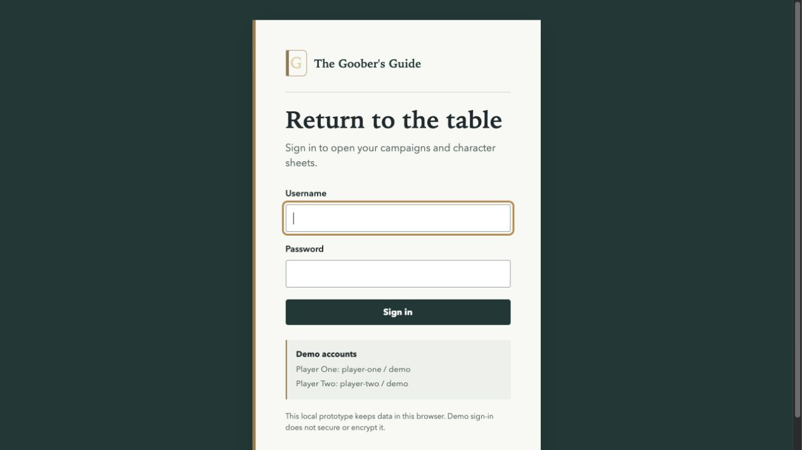
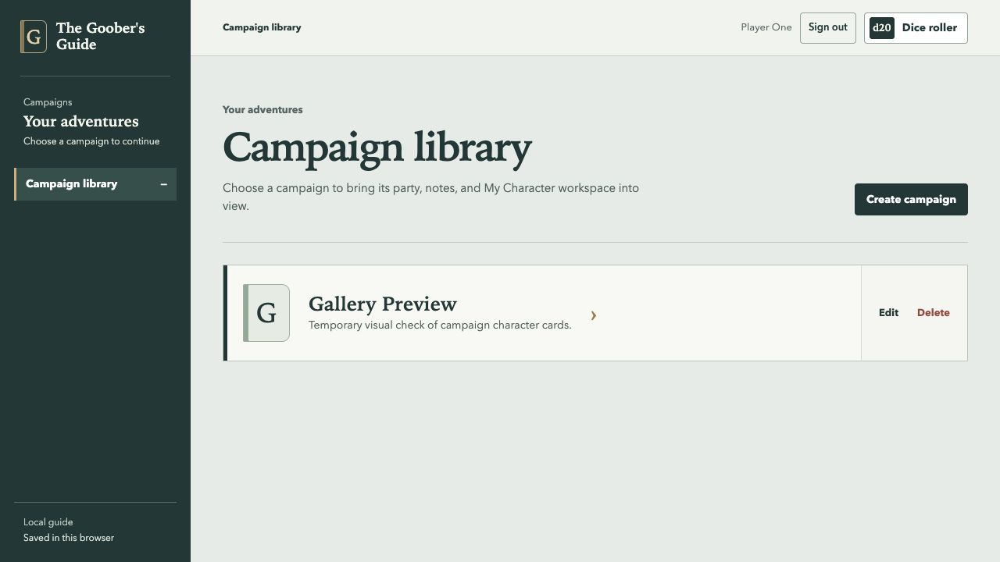
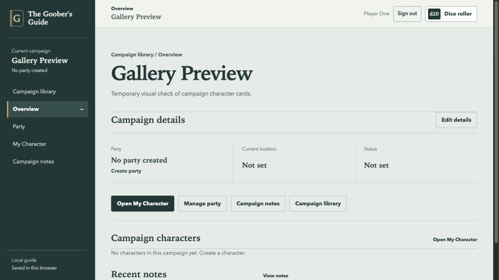
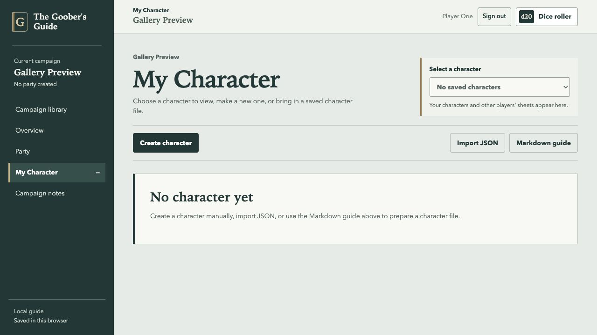
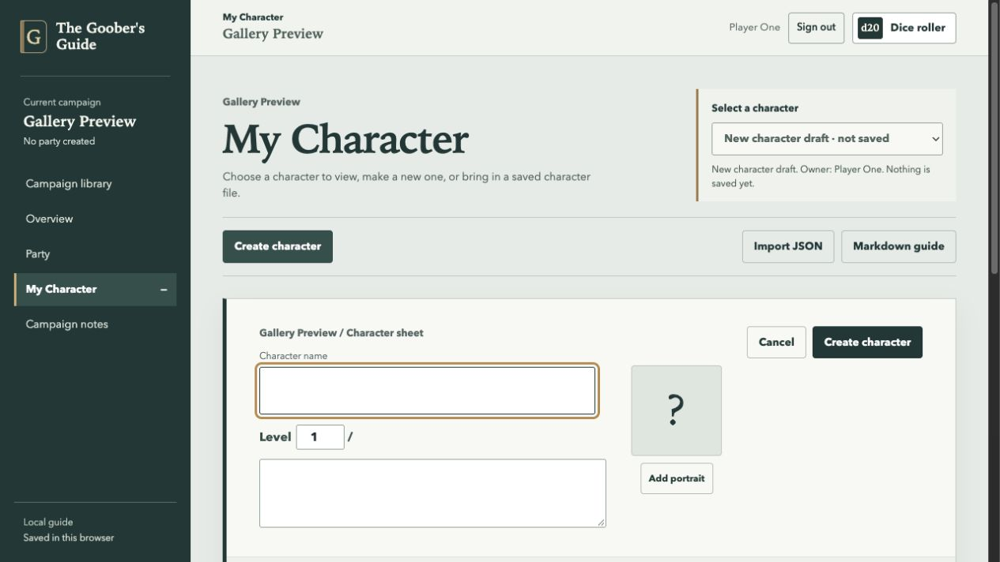
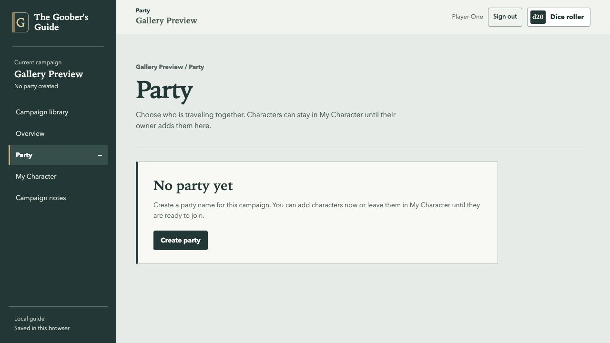
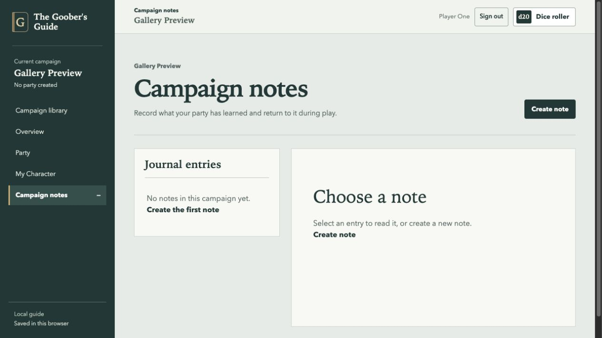
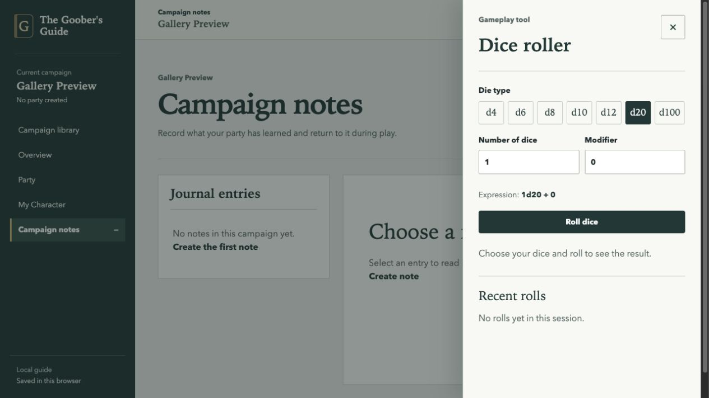

# Product implementation gap analysis

**Reviewed:** November 7, 2026  
**Repository baseline:** `main`, commit `70bd44c`; working tree clean before this review  
**Target:** [PRODUCT_v0.2.md](PRODUCT_v0.2.md), especially sections 5–9, 12, and 13  
**Status:** Analysis and proposed validation sequence only; no feature implementation or database design is authorized by this document.

The existing local application provides a useful foundation for **My Character** and the roster portion of **My Party**. **My Adventures and its collaboration model are missing.** The main change is to connect characters and party context to lightweight, participant-managed objectives while preserving the working sheet, campaign, notes, and dice flows.

Start with an isolated Adventures prototype. Validate creation, participation, consent, and audience changes before choosing a production database or extending live persistence. Private adventures cannot become a real shared feature through UI hiding or the current demo sign-ins.

## Review scope and specification alignment

This review inspected application routing and state, all feature areas, persistent models and validation, services, the stylesheet, design fixtures, the test suite, and the product/design documentation. It also opened the running application and captured its current screens. Section 7 records checks and evidence limits; the appendix contains the screenshots.

The requested v0.2 direction is present in **`docs/PRODUCT_v0.2.md`**, while **`docs/PRODUCT.md` still identifies itself as v0.1**. Existing instructions and design documents point to the latter. This analysis uses v0.2 as the comparison target because that is the explicit review request. It does not silently replace the older implementation contract.

| Owning document                                                     | Current discrepancy                                                                                                                                    | Recommended follow-up before implementation                                                                                                                                                         |
| ------------------------------------------------------------------- | ------------------------------------------------------------------------------------------------------------------------------------------------------ | --------------------------------------------------------------------------------------------------------------------------------------------------------------------------------------------------- |
| [PRODUCT.md](PRODUCT.md) and [PRODUCT_v0.2.md](PRODUCT_v0.2.md)     | Two competing product versions; the canonical path still centers the character sheet and campaign documentation.                                       | Establish one canonical v0.2 product document and identify the older version as historical. Preserve the version distinction until that change is approved.                                         |
| [MVP_SCOPE.md](MVP_SCOPE.md) and [AGENTS.md](../AGENTS.md)          | Define the local v0.1 baseline, globally visible sheets, and exclusions for real accounts, cloud storage, synchronization, and complex permissions.    | Preserve these safeguards for the current application. Separately define which v0.2 work is mock UI, later local behavior, or a secure shared release. This review does not authorize backend work. |
| [UI_UX_BLUEPRINT.md](UI_UX_BLUEPRINT.md)                            | Keeps the existing sitemap, treats objectives as an optional Overview/notes extension, and prioritizes recaps.                                         | Add Adventures as a first-class destination with participant and consent flows; make notes optional support. Keep the design language and existing workflows.                                       |
| [UI_PROTOTYPE_ROADMAP.md](UI_PROTOTYPE_ROADMAP.md)                  | Starts with Library → Overview → sheet → dice refinement; later objectives have no collaboration model.                                                | Plan a separate Adventures-first sequence using section 5. Retain useful regression checks and manual visual approval gates. Do not infer phase completion from a planning document.                |
| [DESIGN.md](DESIGN.md)                                              | Provides a suitable visual foundation but describes a sheet-centered hierarchy and contains a stale reference to four sheet tabs.                      | Extend hierarchy and permission-state patterns; retain all five existing tabs.                                                                                                                      |
| Blueprint, roadmap, and MVP map requirements                        | Describe a live Overview map, but `CampaignOverview` currently has no map rendering or save callback. Map model, component, service, and tests remain. | Record the map as dormant functionality. Preserve its stored data and do not restore or remove it as part of Adventures planning.                                                                   |
| [SETUP.md](SETUP.md) and [MVP_VERIFICATION.md](MVP_VERIFICATION.md) | Setup describes schema 3; actual storage is schema 5. The verification report records an earlier 53-test run and earlier browser checks.               | Update these in a later documentation pass. Current checks below supersede neither untested browser behavior nor historical approval status.                                                        |

## 1. Existing functionality that already satisfies v0.2

“Satisfies” below applies to the stated local capability, not to production privacy or multiplayer collaboration.

| Capability                                     | Current implementation and evidence                                                                                                                                                                                           | v0.2 coverage / preservation rule                                                                                                                |
| ---------------------------------------------- | ----------------------------------------------------------------------------------------------------------------------------------------------------------------------------------------------------------------------------- | ------------------------------------------------------------------------------------------------------------------------------------------------ |
| Campaign library and separation                | `CampaignLibrary`, `campaignService`, and campaign-aware hash routes support create, open, edit, confirmed deletion, and separate campaign records.                                                                           | Supports §5.1. Keep creation focused on name/description, with party setup inside the campaign.                                                  |
| Optional party and explicit roster membership  | `Campaign.partyName` and `partyMemberCharacterIds`; `PartyWorkspace` separates members from other campaign characters. `partyService` checks character ownership and campaign identity.                                       | Supports §5.3. A character can remain outside the party; only its owner changes its roster membership.                                           |
| Multiple characters per player                 | `Character` has `campaignId` and `ownerUserId`; the selector exposes campaign sheets, ownership labels, and read-only variants. Services reject another demo user's edits/deletion.                                           | Useful basis for §5.4 and character-based participation. Preserve visible read-only sheets under the current local scope.                        |
| Interactive manual character sheet             | `CharacterSheetPreview` is the live editor despite its name. Identity, abilities, combat values, skills/saves, attacks, inventory/currency, categorized features, notes, and structured spells are editable across five tabs. | Covers much of §5.4. Keep homebrew fields and entered mechanics; no rules engine or automatic progression. See the modifier caveat in section 2. |
| Quick HP and explicit sheet drafts             | Current/temporary HP save on commit; invalid quick entries produce errors. Full edits use separate saved/draft state, Save/Cancel, and navigation protection.                                                                 | Supports during-play interaction without repeatedly editing the full sheet. Preserve these protections.                                          |
| Reviewed character JSON import                 | Paste/upload validates a version-2 character document, stages a new editable sheet, and saves only after confirmation. IDs and ownership are reassigned to the current context; portraits are omitted.                        | Reusable review-before-apply behavior for §5.4/§7.5. This is partial import coverage, not native Markdown ingestion or reconciliation.           |
| Portable character exports and local portraits | JSON/Markdown export, portrait upload/crop/remove, and structured content display exist. Exports omit local portrait and application ownership fields.                                                                        | Preserve existing conveniences; exports must not become an indirect path to private adventures.                                                  |
| Lightweight campaign notes                     | `CampaignJournal` and `noteService` provide categorized CRUD, recent-note ordering, explicit saves, and draft protection.                                                                                                     | Satisfies the optional notes capability in §5.6. Notes may remain available without being required for Adventures.                               |
| Global dice                                    | Standard d4–d100, 1–20 dice, whole-number modifiers, faces/totals, and the newest ten rolls in page-session memory. The native dialog preserves the route and restores trigger focus.                                         | Covers §5.7. Keep this available from any future Adventure view. Character-specific shortcuts remain future work.                                |
| Defensive local persistence                    | `AppRepository`, `LocalStorageRepository`, and validation provide schema 5 storage, legacy recovery, original-data backups before recovery saves, quota feedback, and blocked writes for unreadable/unsupported payloads.     | Supports the local validation stage in §12. These are data integrity protections, not access controls.                                           |
| Shared shell and visual conventions            | Active campaign context, library return, responsive menu, labeled controls, feedback, focus styling, paper surfaces, and forest navigation exist.                                                                             | Reuse for the integrated platform rather than replacing working navigation and sheet presentation.                                               |
| DM-independent operation                       | No DM service, private AI-project connection, narrative engine, or automatic quest adjudication exists.                                                                                                                       | Consistent with the authority boundary in §3.4/§7.5. Keep content player-maintained and imports explicitly reviewed.                             |

## 2. Existing functionality that requires changes

| Area                        | Current behavior / gap                                                                                                                                                                                 | Proposed change and boundary                                                                                                                                                                                                                                           |
| --------------------------- | ------------------------------------------------------------------------------------------------------------------------------------------------------------------------------------------------------ | ---------------------------------------------------------------------------------------------------------------------------------------------------------------------------------------------------------------------------------------------------------------------- |
| Campaign Overview           | Leads with campaign details, links, all-character gallery, and recent notes. No objective, next-step, Main-adventure, or participant-specific content.                                                 | Add a concise My Character entry, My Adventures summary, party summary, and authorized shared context (§5.2/§9). Keep location/status optional and retain existing routes and records.                                                                                 |
| Navigation and naming       | `App.tsx` has only login, campaigns, campaign, party, characters, and notes routes. “Your adventures” is currently campaign-library copy.                                                              | Prototype one Adventures destination and list/detail/create subflows. Align Party/My Party and Adventures/My Adventures labels consistently; distinguish campaigns from Adventure Threads. No need for separate NPC, Session, or Objectives destinations.              |
| My Character default        | A remembered character is per campaign, not per account, and can be another player's sheet. `selectedCharacterId` returns a valid remembered selection before considering ownership.                   | Preserve browsing read-only sheets. Adventure creation must choose an owned character; offer an owned-character choice or creation path when the selected sheet belongs to someone else. Consider account-specific selection later.                                    |
| Manual modifier precedence  | Imports and saves retain explicit modifiers. However, `CharacterSheetPreview.updateAbility` recalculates and replaces the modifier whenever a score changes.                                           | Validate an override-preserving interaction or explicit reset/confirmation. v0.2 says entered modifiers take precedence; a score edit should not silently erase a confirmed homebrew value. No rules-engine expansion is needed.                                       |
| Character import            | The Markdown guide asks the player to convert externally to JSON. The app parses JSON and always creates a new character. It retains no source snapshot, field comparison, or reviewed update history. | Keep this working path. Prototype native Markdown/text review and an explicit create-versus-update choice, then field-level reconciliation against an existing owned sheet (§5.4). Never treat repeat import as silent replacement.                                    |
| Party visibility            | Party and Overview show campaign characters and link to full read-only sheets. There is no approved-summary or character-field privacy policy.                                                         | Preserve current local visibility. For a shared release, separately define approved summaries and permitted sheet access. Adventure participation must not automatically expose inventories, character notes, or another character's editable data.                    |
| Notes emphasis              | Journal categories include sessions, quests, NPCs, and locations; roadmap puts recap templates ahead of objectives. Notes require both title and content and are shared between demo users.            | Keep existing notes intact and optional. Adventures need title-only capture plus separate status/participants/audience; do not repurpose shared notes as secret threads or require recaps/NPC biographies.                                                             |
| Ownership and authorization | Character mutations receive a demo actor ID, but campaign and note services have no account/membership authorization. All persistent records load into one client.                                     | Reuse local ownership behavior only as a demonstration. A shared product needs authenticated actors and server checks, including organizer restrictions; see section 6.                                                                                                |
| Deletion                    | Campaign/character/note deletion is immediate after a native confirmation. Character deletion removes roster membership; campaign deletion cascades through characters and notes.                      | Preserve existing local behavior. Do not copy hard deletion to collaborative adventures: creator-controlled recoverable archive/removal is required for the first shared release. Decide new relationship effects before extending cascades.                           |
| Integration                 | Characters, party, notes, and dice are adjacent features, with no Adventure links or attributed collaboration.                                                                                         | Connect thread participants to permitted character profiles, characters to authorized objectives, and Overview to next steps. A link must not cause automatic inventory transfer, rewards, HP changes, or narrative outcomes.                                          |
| Application coordination    | `App.tsx` owns routing, user/data state, callbacks, import staging, and dialogs; services synchronously save the entire `AppData` object.                                                              | Keep the current app intact during prototype work. Later add a bounded Adventures feature rather than embedding all its policy in the shell. Shared async reads/mutations and conflicts will need a separate design; swapping the storage class alone is insufficient. |

The map discrepancy is documentation drift, not a reason to restore the map during this work. Likewise, existing notes and full-sheet visibility should not be removed merely because v0.2 makes them less central or introduces future privacy requirements.

## 3. Missing screens and user workflows

### Required Adventures surfaces

| Screen or subflow           | Minimum content and actions                                                                                                                                                                         | States to validate                                                                                                                                                                                                |
| --------------------------- | --------------------------------------------------------------------------------------------------------------------------------------------------------------------------------------------------- | ----------------------------------------------------------------------------------------------------------------------------------------------------------------------------------------------------------------- |
| Adventures index            | Mine, Shared with party, Completed or equivalent filters; title, type, player-tracked status, next step, and permitted participants. Search/filter only the authorized set.                         | Empty, populated, no matches, completed/reopened, no party, multiple characters, campaign switch, unavailable link. Unauthorized private records contribute no placeholders, counts, ordering, or previews.       |
| Quick New Adventure         | Title; infer campaign, creator, owned character, Personal type, Pending status, and Participants-only audience. Optional details appear progressively.                                              | Save with title only, blank-title error, cancel/dirty draft, no owned character, read-only selected character, optional next step/NPC/location. Main creation must clearly announce its party audience.           |
| Adventure detail/editor     | Title, type, status, audience, participants, description, next step, free-text references, short updates, and optional handoff sources.                                                             | Solo, accepted collaborator, party reader, completed, archived, unauthorized/missing, unsaved changes, failed save, stale edit. “Completed” means player-tracked progress, not DM adjudication.                   |
| Participant management      | Propose a campaign character; collect current participants' expansion approvals; send an invitation only after approval; show pending/accepted/declined/withdrawn states.                           | Solo-to-duo-to-trio; proposal declined/canceled; stale approval; invitee accepts/declines; same owner with several characters; candidate outside party but in campaign. Type is independent of participant count. |
| Invitation response         | A minimal invitation entry with Accept/Decline and character identity. Full private content appears only after acceptance.                                                                          | Wrong account, revoked/stale invitation, already answered, changed participant set, safe preview without private title or source text. Exact pre-acceptance disclosure needs validation.                          |
| Party-sharing approval      | Propose Share with party; show explicit approvals from every accepted participant; activate only when unanimous.                                                                                    | Pending, declined, approved, canceled, consent withdrawn, participant joins/leaves, no party. Withdrawal removes subsequent party-reader access. It cannot recall previously copied content.                      |
| Collaboration and lifecycle | Accepted participants edit ordinary fields, add attributed updates, complete/reopen, and leave. Creator gets confirmed recoverable removal; another participant's removal requires their agreement. | Creator versus collaborator actions, last participant leaving, creator leaving, archive/restore, failed or concurrent changes. Last-participant and former-creator rights remain decisions.                       |
| Reviewed DM handoff         | Paste/upload text/Markdown, inspect source and proposed fields, correct ambiguity, choose a permitted existing thread or new private thread, confirm/cancel.                                        | Unrecognized/partial source, invalid file, ambiguous status, duplicate import, stale target, insufficient permission, preserved audience. Never auto-invite, share, or update a character from adventure import.  |
| Integrated Overview         | My Character, authorized pending/in-progress threads, next steps, party roster, Main and explicitly shared context.                                                                                 | Different viewers receive different results; unauthorized threads are absent. Empty modules provide useful actions without requiring campaign documentation.                                                      |
| Character/party connections | Authorized thread links from a character or party context and permitted profile links from thread participants.                                                                                     | Same account owns multiple characters; unrelated character; party viewer can read shared thread but cannot edit it; private-thread access does not grant full-sheet access.                                       |

Invitation and approval surfaces may be in-page panels or dialogs; they do not require a permanent notification center. A Main thread is party-visible context, not an automatic grant of editing rights to every party member. Its accepted participants still determine who collaborates.

### End-to-end workflow gaps against v0.2

| Product workflow                     | Present coverage                                                  | Missing transition / acceptance target                                                                                                                             |
| ------------------------------------ | ----------------------------------------------------------------- | ------------------------------------------------------------------------------------------------------------------------------------------------------------------ |
| W1: Create a private objective       | Campaign and character context exist.                             | Save a minimal private thread, navigate away, find it again under Mine and Overview; another viewer sees nothing about it.                                         |
| W2: Invite and collaborate           | Character ownership and roster selection provide references only. | Existing participants approve expansion, invitee accepts, then both can edit and see attribution. An invitation or proposal alone grants no private-detail access. |
| W3: Share with party                 | No coverage.                                                      | All accepted participants approve, eligible party accounts gain read access, and withdrawal or unapproved participant change removes that audience.                |
| W4: Import a DM handoff              | Character JSON review offers an interaction precedent.            | Adventure text/Markdown proposals, retained source/provenance, target selection, selective application, and cancellation without changes.                          |
| W5: Return before the weekly session | Overview, sheets, roster, and global dice exist.                  | Answer “What am I involved in, and what is next?” from authorized Main/personal/shared context, then move to character/dice and return.                            |

Real account onboarding and campaign membership management are also missing for the eventual shared product. They are later foundation work, not prerequisites for synthetic UI validation and not reasons to add registration now. A standalone Campaign Settings screen is listed in v0.2's IA but has no specified essential workflow; retain existing edit locations and defer a new settings destination until a concrete need is validated.

## 4. Reusable components and existing data structures

### Architecture and interface reuse

The stack is React 19, TypeScript, Vite, Tailwind CSS 4, and Vitest. React state and native browser capabilities provide the behavior; there is no router library, state framework, backend, ORM, or production authentication layer. Most visual styling lives in [src/index.css](../src/index.css).

| Existing source                                                                                                                                | Reuse opportunity                                                                                                      | Limit                                                                                                                                    |
| ---------------------------------------------------------------------------------------------------------------------------------------------- | ---------------------------------------------------------------------------------------------------------------------- | ---------------------------------------------------------------------------------------------------------------------------------------- |
| [App.tsx](../src/App.tsx)                                                                                                                      | Campaign-aware hash links, active context, mobile navigation, demo-session handling, feedback, and native dice dialog. | No Adventure route or authorization-aware read boundary. Extend only after prototype validation; avoid a shell rewrite.                  |
| [CampaignJournal.tsx](../src/features/notes/CampaignJournal.tsx)                                                                               | List/detail composition, readable paper editor, explicit Save/Cancel, timestamps, empty states.                        | Shared campaign notes have no participants or privacy. Reuse presentation patterns, not note authorization semantics.                    |
| [CharacterWorkspace.tsx](../src/features/characters/CharacterWorkspace.tsx)                                                                    | Contextual selector, owner/read-only messaging, progressive import disclosures, paste/upload choices.                  | Adventure participant selection must require ownership for the creating character and track invited characters independently.            |
| [CharacterSheetPreview.tsx](../src/features/characters/CharacterSheetPreview.tsx)                                                              | Separate draft/saved state, review-before-save, keyboard tabs, combat/identity summaries.                              | Large feature component, not a generic form library. Extract only narrowly useful pieces if later implementation needs them.             |
| [PartyWorkspace.tsx](../src/features/characters/PartyWorkspace.tsx) and [CampaignOverview.tsx](../src/features/campaigns/CampaignOverview.tsx) | Character identity rows, portraits, owner labels, roster relationships, direct profile links.                          | Feed authorized summaries into new surfaces; do not infer adventure membership from roster membership.                                   |
| [useUnsavedChanges.ts](../src/shared/ui/useUnsavedChanges.ts)                                                                                  | Draft-loss warnings for navigation and unload.                                                                         | Shell currently registers a single active guard; nested editors need deliberate coordination.                                            |
| [characterImport.ts](../src/features/characters/characterImport.ts) and [characterExport.ts](../src/features/characters/characterExport.ts)    | Validation, portable format versioning, regenerated IDs, and explicit import/export boundaries.                        | Character JSON is a different format from an adventure handoff; it cannot supply thread consent, identity, or a reconciliation baseline. |
| [localStorageRepository.ts](../src/shared/persistence/localStorageRepository.ts) and [validation.ts](../src/shared/persistence/validation.ts)  | Dedicated persistence adapter, record validation, recovery and error patterns.                                         | Synchronous whole-store access is local only; filtering it in React cannot protect private records.                                      |
| [sampleData.ts](../src/design/sampleData.ts)                                                                                                   | Existing example of isolated typed fixtures.                                                                           | Not loaded into live application persistence; keep future Adventures fixtures equally isolated.                                          |

There is an existing design system of tokens and CSS conventions, rather than a packaged shared React component library. Reuse `page-heading`, `section-heading`, primary/quiet buttons, field styles, ledger rows, status/error feedback, and paper surfaces before introducing new abstractions.

Preserve forest `#183936`, paper `#F8F9F5`, ground `#E6EBE8`, ink `#1C2B2D`, muted ink `#526763`, rule `#CBD5CF`, and restrained brass `#A37942`. Keep the Iowan/Palatino/Georgia display stack and Avenir/Segoe UI interface stack. Use words alongside status colors, compact headings, thin dividers, and restrained panels rather than a new decorative theme.

Retain the 244 px desktop sidebar and overlay breakpoint around 1,050 px. Use the established stacked layouts below roughly 760 px and contained tab scrolling. Consent controls need explicit “Approve,” “Decline,” and “Withdraw consent” labels, visible focus, accessible status announcements, and focus return. Do not represent sharing with an immediate toggle or ambiguous lock icon.

### Existing persistent relationships

| Model                        | Available fields / relationships                                                                                 | What it cannot represent                                                                                                           |
| ---------------------------- | ---------------------------------------------------------------------------------------------------------------- | ---------------------------------------------------------------------------------------------------------------------------------- |
| `AppData` / `AppPreferences` | Schema 5; campaign, character, and note arrays; selected character by campaign.                                  | No adventures, campaign-account membership, invitations, consent, provenance, or audit history. Selection is not account-specific. |
| `Campaign`                   | ID, name/description, optional party name, roster character IDs, optional location/status/map image, timestamps. | No organizer account or campaign permissions. Party is embedded in the campaign, not a separate persisted entity.                  |
| `Character`                  | Campaign ID, fixed `DemoUserId` owner, rich gameplay fields, portrait, timestamps.                               | No production account identity, privacy policy, revision history, source snapshot, or adventure relationships.                     |
| `CampaignNote`               | Campaign ID, title, content, optional category, timestamps.                                                      | No author, participants, status, audience, approvals, or private access boundary.                                                  |
| Demo session                 | One of two hardcoded identities in sessionStorage.                                                               | No verified identity, campaign membership, secure session, or collaboration.                                                       |
| `RollResult`                 | Expression, individual dice, modifier, total, timestamp; transient recent history.                               | No persistent campaign/adventure association is needed for the proposed workflows.                                                 |

Do not encode Personal, Side, and Main as separate stores or solo/duo/trio entity types. Reuse campaign and character IDs as references, but give adventures their own conceptual lifecycle instead of putting JSON or secret content into `CampaignNote.content`.

## 5. Proposed UI prototype milestones, beginning with Adventures

These milestones are proposals for v0.2 Stage A. None has been implemented by this review. Use a separate non-persistent preview with synthetic campaign/character/adventure records. It must not write fixtures to the live repository or invoke a live migration. Simulated invitations and approvals must say they are demonstrations, not multiplayer or secure privacy.

Use at least three simulated accounts and several characters, including two owned by the same account, a campaign character outside the party, a party reader who is not a participant, and an organizer who is not a participant. The current two demo identities alone do not cover the required viewpoints.

| Milestone                                                  | Prototype scope                                                                                                                                                                                      | Acceptance and dependencies                                                                                                                                                                                                                                  |
| ---------------------------------------------------------- | ---------------------------------------------------------------------------------------------------------------------------------------------------------------------------------------------------- | ------------------------------------------------------------------------------------------------------------------------------------------------------------------------------------------------------------------------------------------------------------ |
| **A1 — Adventures: private capture and return**            | Adventures list, title-only creation, detail, next step, four player statuses, Completed/reopen, Personal/Side presentation, and return navigation. Include minimal shell entry in the preview only. | W1 works using synthetic state; default character is owned; no party is required; canceled drafts do not create records. A different viewer has no private title/count/placeholder. No notes or handoff is required to create an objective.                  |
| **A2 — Invitations and collaborative participation**       | Character picker, expansion proposal, unanimous existing-participant approval, invitation acceptance/decline, accepted collaborator editing, attributed updates, leave/removal agreement states.     | Depends on A1. Walk solo → duo → trio with distinct accounts; no private details before acceptance; rejection leaves membership unchanged. Multiple characters under one account remain distinct participants.                                               |
| **A3 — Consent and lifecycle**                             | Share proposal, approval progress, decline, party-reader view, withdrawal, participant-change revalidation, Main audience, creator archive/restore confirmation.                                     | Depends on A2. No unilateral sharing; stale approvals cannot grant access; revoked or unapproved sharing returns private. Main/type changes cannot bypass disclosure approval. Demonstrate a nonparticipant organizer seeing no secret data.                 |
| **A4 — Connected campaign experience**                     | Overview's My Character/My Adventures/Party/shared context; authorized links between threads, character profiles, and party; global dice and return paths. Keep notes optional.                      | Depends on audience states from A3. W5 works without a campaign recap. Audience filtering occurs before summary counts/search/order. Preserve existing sheet access conventions in the live app; mock future profile permissions separately.                 |
| **A5 — Reviewed adventure handoff**                        | Paste/upload text/Markdown, source/proposed-field review, corrections, create-new versus attach-existing, cancellation and source history.                                                           | Depends on A1–A3. W4 preserves audience/membership and unrelated sheet state. Unknown fields stay ambiguous; imported “completed” is reviewed player status. No external AI/DM connection is implied.                                                        |
| **A6 — Character continuity and full workflow validation** | Repeat character-import comparison, choose changes, preserve local resources/manual overrides, permitted character-to-adventure links, and optional manually entered roll shortcuts.                 | Depends on established integration. Reconcile DM snapshots without silent overwrite; exercise all W1–W5 across viewpoints, campaign switches, direct links, and narrow screens. Do not require trackers, transfers, or preset systems to approve Adventures. |

For each milestone, review desktop 1,440 px, tablet 768 px, and phone 375 px; check keyboard navigation, labels, focus, long titles/content, empty/error states, and no page-level horizontal overflow. Show save failure, inaccessible links, and stale approval/edit states in the mock where real networking does not yet exist.

After each substantial UI milestone, run the project's read-only `qa_reviewer` and `ui_reviewer` reviews independently in parallel, consolidate confirmed issues, and complete relevant checks. Then stop for the user's manual visual review and explicit approval before starting another milestone, as required by [AGENTS.md](../AGENTS.md). This analysis is not a completed UI phase and does not claim those reviews or visual approvals.

## 6. Data and authorization requirements discovered from the workflows

### Conceptual responsibilities, not a physical schema

| Concept                            | Data required by the validated workflow                                                                                                           | Invariant / question to retain                                                                                                                                                  |
| ---------------------------------- | ------------------------------------------------------------------------------------------------------------------------------------------------- | ------------------------------------------------------------------------------------------------------------------------------------------------------------------------------- |
| Adventure                          | Campaign, creator account, title, independent type/status/audience, description, next step, optional NPC/location text, timestamps, revision.     | Required creation values are inferred where possible. At least one accepted owned character starts the thread. No structured NPC database is required.                          |
| Participation                      | Adventure and character references; invitation/accepted/left state; actors and response times.                                                    | Participation is per character; access resolves through its owner account. All references must belong to the same campaign. Party membership is separate.                       |
| Expansion proposal and invitation  | Proposed character, proposer, current participant-set version, required approvals, sent/accepted/declined/canceled state.                         | Approval to disclose precedes sending; acceptance precedes private-detail access. An old invitation must not override changed membership or approvals.                          |
| Party-sharing proposal and consent | Explicit approval/decline/withdrawal per accepted participant, actor/time, and membership/audience version to which it applies.                   | A pending request is not party visibility. All current accepted participants must approve; withdrawal or an unapproved new participant removes party access.                    |
| Adventure update/history           | Thread, actor, timestamp, content or changed fields, revision/source.                                                                             | Attribute collaboration and preserve participant-visible history. History inherits the thread's authorization; it cannot leak prior private state through summaries.            |
| Handoff/reconciliation             | Original text or permitted source reference, claimed source, import time/actor, proposed fields, reviewer decisions, target and applied revision. | A provenance label does not prove DM authorship. Retain uncertainty; review before applying. Character reconciliation additionally needs a baseline and explicit field choices. |
| Lifecycle                          | Creator, completed/reopened state, archived/removed state, actor/time, recoverability.                                                            | Progress status is independent of archive and DM outcomes. Preserve group contributions and define restoration/access behavior.                                                 |
| Shared foundation                  | Authenticated users, campaign membership, ownership, roster membership, and authorization-aware reads/mutations.                                  | Organizers have no private-thread override. Keep storage technology and detailed tables undecided until workflows stabilize.                                                    |

### Intended access matrix for a secure shared release

This matrix describes v0.2 requirements; today's local application does not enforce it securely.

| Actor / relationship                             | Read private details                               | Read Main or party-shared thread                          | Ordinary edits / updates  | Membership and audience actions                                                                                                   | Destructive action                                                                       |
| ------------------------------------------------ | -------------------------------------------------- | --------------------------------------------------------- | ------------------------- | --------------------------------------------------------------------------------------------------------------------------------- | ---------------------------------------------------------------------------------------- |
| Accepted participant's owner account             | Yes                                                | Yes                                                       | Yes, collaboratively      | Propose invitation/sharing, approve/decline, withdraw sharing consent, leave; another participant's removal needs their agreement | Creator-only confirmed recoverable removal; creator-after-leaving rights need resolution |
| Invited account before acceptance                | No; only a deliberately limited invitation surface | Only if independently eligible as a current party account | No                        | Accept/decline its invitation; no automatic participant access                                                                    | No                                                                                       |
| Current party-character owner, not a participant | No                                                 | Yes, while that party audience is active                  | No                        | No participant or consent powers                                                                                                  | No                                                                                       |
| Campaign member outside party, not a participant | No                                                 | No                                                        | No                        | No                                                                                                                                | No                                                                                       |
| Organizer who is not a participant               | No special access                                  | Only if independently eligible through party membership   | No special editing rights | No privacy override                                                                                                               | No private-thread override                                                               |
| Unauthenticated or unrelated account             | No                                                 | No                                                        | No                        | No                                                                                                                                | No                                                                                       |

Eligibility must be derived from the signed-in actor and current relationships, never a client-supplied owner ID. Decide how campaign membership termination interacts with accepted participation before a shared release; campaign membership alone must never grant private access.

### Authorization and transition requirements

1. Authorize before returning details, dashboard/list/search results, counts, ordering, exports, sources/attachments, history, or notification previews. Unauthorized private records must be indistinguishable from absent records at the UI boundary; a generic unavailable state must not confirm a secret title or existence.
2. Recheck permissions on each mutation and direct-link read. UI controls are affordances, not the enforcement boundary. Do not send all adventures to the browser and filter afterward.
3. Model thread status, invitation state, participant-expansion approval, sharing proposal, and effective audience separately. A thread being Pending has no bearing on whether an invitation is pending or a share request is approved.
4. Bind approvals to the applicable participant set and disclosure proposal. Revalidate when people join or leave. A new accepted participant must approve the party audience before it remains active; otherwise revert private. Type changes to Main must not circumvent this requirement.
5. Apply acceptance, participant changes, consent evaluation, audience changes, and relevant history atomically in the shared implementation. Concurrent approval/revocation must not expose a transient unauthorized state. Use revision/conflict handling and idempotent responses so stale editors or duplicate clicks cannot silently override decisions.
6. Resolve party readers from accounts owning characters currently on the campaign roster. Leaving the roster removes that read entitlement unless the account remains an accepted participant or owns another roster character. Do not automatically enroll all of an account's characters in an adventure.
7. Keep adventure editing separate from character editing and external DM authority. Marking Completed, importing a handoff, or sharing a thread must not award items/XP, change a sheet, adjudicate a quest, or update an external DM record.
8. Treat handoff files as untrusted content. Review any extracted fields; render source text safely; define file limits and failures. Source access follows the destination thread. No automatic publishing, external fetching, or secret content copied into shared notes.
9. Reevaluate live views and cached results after consent/roster changes. Prevent stale dashboards, source links, exports, or notifications from continuing to disclose newly private records. Previously seen information cannot be recalled.

### Decisions to validate before storage/API design

- What may an invited person see before acceptance? Start with generic invitation metadata and the invited character, with no secret title, source, participant list, or objective text; validate how they can make an informed choice without premature disclosure.
- Is consent recorded separately for every participating character when one account owns several? v0.2 says every accepted participant approves. Keep character-level records; any combined account action must explicitly cover the listed characters.
- What happens when the creator or final participant leaves, when a character is deleted/transferred, or when an account exits a campaign? Preserve contributions and revoke access deliberately rather than silently cascading or transferring it.
- Who may create/edit Main context, can there be several Main threads, and how does changing type affect audience? Do not infer organizer authority or allow converting a private thread to Main to bypass consent.
- Does approving party visibility include future roster members and all existing handoffs/history? Make the audience promise explicit; whole-thread sharing is the current product direction, while selective excerpts would require a separate decision.
- How long are invitations/proposals valid, how are obsolete decisions canceled, and who can restore an archived thread? Prototype stale/canceled states before choosing retention rules.
- What character summary fields are approved for party viewers, and how should repeat imports reconcile DM snapshots against local HP, inventory, and homebrew edits? Keep these permissions separate from adventure consent.

These are workflow and policy decisions, not a request to choose a database provider, generate an ERD, create migrations, or implement permissions now.

## 7. Dependencies, risks, and recommended implementation order

### Recommended order and release gates

| Order | Deliverable / dependency                                                                                                   | Gate                                                                                                                                                                                                                                                    |
| ----- | -------------------------------------------------------------------------------------------------------------------------- | ------------------------------------------------------------------------------------------------------------------------------------------------------------------------------------------------------------------------------------------------------- |
| 1     | Reconcile canonical product references and agree on the Adventures prototype scope using this analysis.                    | No existing source/document contract is silently replaced; preserve local baseline and map data.                                                                                                                                                        |
| 2     | Run A1–A3: manual Adventures, invitations, consent, and lifecycle with synthetic data.                                     | User validates fast capture and understands who can see/edit content; each milestone receives explicit visual approval.                                                                                                                                 |
| 3     | Run A4–A6: integrated Overview/character/party navigation, reviewed handoffs, character continuity, and regression review. | W1–W5 and audience scenarios are validated at desktop/mobile widths. Handoff/reconciliation complexity does not delay the basic manual prototype.                                                                                                       |
| 4     | If separately approved, implement v0.2 Stage B: a bounded local Adventure create/view/edit/status slice.                   | Define local model, validation/recovery and export compatibility first; later schema changes require their own plan. State clearly that private views are simulations and LocalStorage is inspectable. No real invitations or secret shared deployment. |
| 5     | Design and implement Stage C: secure shared foundation around validated workflows.                                         | Real identity, campaign membership, server authorization, authorized query/mutation contracts, concurrency, recoverable lifecycle, and privacy tests before genuine private multiplayer use. Production schema follows this design.                     |
| 6     | Stage D: production handoff imports/reconciliation and selected conveniences.                                              | Keep originals/provenance and review steps; implement against authorized targets. Rich NPC links, resource transfers, notifications, campaign backup, and broader automation remain separate priorities.                                                |

The existing synchronous `AppRepository.load/save` boundary is useful for local testing but is not a drop-in secure backend contract. A future server must return only authorized data and accept scoped commands rather than whole-client snapshots. `updatedAt` alone provides neither attribution nor conflict prevention. Design this after validation; a production database choice is not needed to answer the UI questions.

### Main risks and mitigations

| Risk                                                 | Consequence                                                                                                        | Recommended mitigation                                                                                                                                  |
| ---------------------------------------------------- | ------------------------------------------------------------------------------------------------------------------ | ------------------------------------------------------------------------------------------------------------------------------------------------------- |
| Treating demo identity/UI filtering as privacy       | All “secret” content remains available through browser storage or an overbroad response.                           | Keep prototypes synthetic; make limitations clear. Gate real private sharing on server enforcement and adversarial access tests.                        |
| Notes or Main type used as a shortcut                | Private content leaks into campaign-wide notes or becomes public through a category change.                        | Use separate adventure concepts and consent transitions. Never auto-copy source text or infer audience from type/count alone.                           |
| Stale consent and simultaneous edits                 | One participant shares after another revokes or joins; contributions are overwritten.                              | Version proposals/participant sets, recheck current permissions, use atomic transitions and conflicts in the shared release. Simulate these states now. |
| Overloading Adventures with DM bookkeeping           | Mandatory session logs, quest stages, NPC databases, or automatic outcomes recreate the original adoption problem. | Title-first capture; optional short next step/reference/update/handoff; label progress as player-maintained.                                            |
| Blanket character visibility carried into production | Adventure access inadvertently exposes personal sheet notes, inventory, or exported data.                          | Preserve current local behavior but define independent approved-summary/profile permissions before shared deployment.                                   |
| Extending destructive cascades                       | Campaign/character deletion destroys collaborative contributions or breaks participants/consent.                   | Decide archive/tombstone and relationship behavior before adding adventures to existing delete services.                                                |
| Prototype fixtures mixed with live data              | Review content alters user records or triggers unintended migration/recovery writes.                               | Isolated in-memory preview and resettable viewpoints; no live repository writes. Keep existing saved campaigns untouched.                               |
| Treating old documentation as current verification   | Dormant map behavior or incomplete phase approval is reported as shipped/approved.                                 | Compare owning code and current checks; record documentation drift and evidence limits explicitly.                                                      |
| Broad redesign or early infrastructure               | Working gameplay paths regress while UI decisions are unsettled.                                                   | Reuse existing tokens/components; prototype one milestone at a time; defer new dependencies, schema/vendor decisions, and application restructuring.    |

### Current verification and test gaps

Checks performed on the unmodified application during this review:

| Check                  | Result                            | Meaning                                                                                                                                                                                                                                                                                                                                                                                                  |
| ---------------------- | --------------------------------- | -------------------------------------------------------------------------------------------------------------------------------------------------------------------------------------------------------------------------------------------------------------------------------------------------------------------------------------------------------------------------------------------------------- |
| `npm test`             | **Pass: 66 tests in 12 files**    | Current service/helper tests pass. They do not establish browser workflow completeness or v0.2 collaboration.                                                                                                                                                                                                                                                                                            |
| `npm run build`        | **Pass**                          | Type checking and Vite production build succeed.                                                                                                                                                                                                                                                                                                                                                         |
| `npm run format:check` | **Fail on existing files**        | Prettier warns on `docs/PRODUCT_v0.2.md` and `docs/UI_PROTOTYPE_ROADMAP.md`; `test.json` contains invalid escaped/HTML-encoded JSON and causes a parser error. These files were left unchanged.                                                                                                                                                                                                          |
| Browser inspection     | **Limited current-screen review** | IAB at `http://127.0.0.1:5173`, approximately 1,280 × 720 viewport. Signed in/out as Player One, opened the existing Gallery Preview campaign, visited Overview/My Character/Party/notes, opened an untouched new-character draft and canceled, opened/closed dice. Route and trigger focus were preserved on dice close. No campaign, character, note, or map records were created, edited, or deleted. |

The test suite covers campaign/party/character/note services, demo-session helpers, LocalStorage validation/recovery, character JSON import/export, portrait/map validation, feature grouping/filtering, and dice calculations/history. Tests live consistently in `tests/` and use Vitest. Map helper tests passing do not mean the map is reachable in the UI.

There are no current automated component/browser journey tests, Adventure tests, authorization-query tests, invitation/consent state tests, shared edit-conflict tests, or Markdown reconciliation tests. The inspected browser campaign had no saved characters, party, or notes; populated and read-only sheet behavior was assessed from source/tests and the historical verification report, not re-exercised with fresh records. The earlier [MVP_VERIFICATION.md](MVP_VERIFICATION.md) is useful historical evidence, not a current v0.2 acceptance result.

Later verification must cover:

- **A1–A4 behavior:** fast creation, owned-character default, return/direct links, complete/reopen, accepted collaborator editing, invited/declined/left states, failed saves, and campaign isolation.
- **Consent invariants:** all approvals required; one decline or withdrawal prevents party access; participant changes invalidate stale decisions; Main/type changes cannot disclose secrets; party readers cannot edit; organizers cannot override privacy.
- **Non-disclosure:** unauthorized users cannot infer private titles, counts, search matches, ordering, participants, source text, histories, exports, attachment URLs, or notification previews. Test reads and writes directly at the server boundary for Stage C, not merely hidden buttons.
- **Identity/relationships:** multiple characters under one account, outside-party participants, roster removal, last participant/creator departure, campaign exit, archive/restore, and approved deletion semantics.
- **Import:** original/proposed/applied fields, ambiguity, cancel, malformed source, stale destination, duplicate import, manual modifier preservation, and no unintended audience or sheet changes.
- **Regression:** existing campaign CRUD, demo sessions, ownership/read-only sheets, party membership, quick HP, five tabs, manual values, portraits, JSON/Markdown export, notes, dice, draft guards, storage failures, and unrelated campaigns.
- **Accessibility/responsiveness:** keyboard order, focus containment/return, announcements, explicit consent labels, touch targets, contrast, zoom/reflow, 375/768/1,440 px layouts, plus screen-reader and physical-device checks. Screenshots alone cannot establish accessibility compliance; those checks were not performed in this review.

The next implementation step should be the separately approved **A1 Adventures prototype** after document alignment. This analysis changes no production code, feature behavior, database schema, or existing roadmap.

## Appendix: current-screen evidence

These screenshots were captured and inspected in this review. They show current surfaces, not proposed v0.2 screens. Each image is a viewport capture; lower content may continue below the visible area.

1. **Sign in.** The focused form, labels, demo credentials, and local-data notice support honest prototype use. It provides no production security. Future consent flows should retain equally clear wording and focus treatment.

2. **Campaign library.** Clear row entry and distinct Edit/Delete actions are reusable. “Your adventures” currently labels campaigns; future navigation should distinguish the campaign library from actual Adventure Threads.

3. **Overview.** Context and gameplay shortcuts are visible. The current hierarchy has no My Adventures/next-step content; the current source also omits the map. Preserve context and introduce concise authorized summaries rather than mandatory record keeping.

4. **My Character empty state.** Creation and progressive import actions are clear. A new adventure must handle “no owned character” explicitly rather than silently selecting someone else's sheet.

5. **Untouched new-character draft.** Owner and unsaved state are explicit, with visible Cancel/Create actions. Reuse draft clarity for thread creation and import review; the screenshot does not verify the lower combat/tab layout or saved-sheet behavior.

6. **Party empty state.** Party setup is optional and contextual. Personal adventures should remain possible without a party, and accepted participation must not imply roster membership.

7. **Notes.** The index/detail paper composition offers a reuse pattern. Notes remain optional; their campaign-shared model is unsuitable for private adventure content.

8. **Dice.** The existing side dialog keeps campaign context behind it. Closing returned focus to the trigger and retained the notes route. Preserve this return loop for new screens; keyboard/screen-reader behavior of future dialogs still needs validation.

## Documentation reconciliation — November 7, 2026

The approved implementation plan establishes `PRODUCT.md` as canonical v0.2 and preserves `PRODUCT_v0.1.md` / `PRODUCT_v0.2.md` as historical snapshots. `MVP_SCOPE.md` remains the current local runtime contract. Blueprint, design, setup, and roadmap now distinguish that baseline from synthetic Stage A work. The conflicts above describe the original review baseline, not the reconciled document authority. A1 alone is authorized for implementation; A2–A6, production persistence, backend work, and migrations remain outside this change. Existing review evidence is retained. Implementation verification and visual approval must be recorded separately after checks.

## A1 implementation follow-up — November 7, 2026

A1 is implemented at the separate development entry `/adventures-preview.html` with synthetic, memory-only state. The existing App, production persistence/schema/services, demo sessions, and map data remain unchanged. See [MVP_VERIFICATION.md](MVP_VERIFICATION.md#a1-adventures-preview-verification--november-7-2026) for dated checks, storage-isolation evidence, reviewer findings/resolutions, screenshots, and limits. The user confirmed A1 as verified and authorized A2 on November 7, 2026. A2 adds only synthetic participation workflows; A3–A6 remain future scope.

## A2 implementation follow-up — November 7, 2026

The user approved A1 and authorized A2. The isolated preview now models per-character invitation approvals, minimal invitation responses, collaborative editing and attributed updates, confirmed departure, and agreed removal. One membership request is active per thread; membership revisions invalidate stale decisions. The final accepted character stays until later lifecycle rules exist. Production state, sessions, schema, and persistence remain outside this change. See [MVP_VERIFICATION.md](MVP_VERIFICATION.md) for A2 checks and the outstanding manual visual gate before A3. Earlier review findings and authorization statements above describe their dated baseline.

## A3 consent-only implementation follow-up — November 7, 2026

The user confirmed A1 and A2 complete and explicitly approved party-sharing consent only. This narrows the proposed A3 “Consent and lifecycle” row above: Main audience and creator archive/restore remain deferred and are not implemented. A4–A6 remain outside the authorized milestone.

The isolated preview now provides proposal-only sharing initiation, explicit per-character unanimity, decline, pending/active withdrawal, proposer cancellation, read-only party access, and consent invalidation on every accepted-membership change. The agreed conservative policy requires a fresh proposal and fresh consent from all current participants after joins or departures. Existing approvals never auto-transfer to a new participant set or proposal. The audience is the whole thread, existing history, and future updates for accounts owning characters currently on the campaign party roster, including future roster members; this is disclosed before approval.

A current unanimous proposal determines effective audience. Party readers cannot edit, invite, respond to consent, complete, or remove participants. Organizers receive no override. No-party adventures remain private. All new state is synthetic and memory-only; production modules, persistence, schema, sessions, and navigation remain unchanged. See [MVP_VERIFICATION.md](MVP_VERIFICATION.md) for tests, layout and storage evidence, independent reviewer findings and resolutions, and limits. Stop for manual visual and functional review before further work. Earlier scope/gate statements above are historical.
